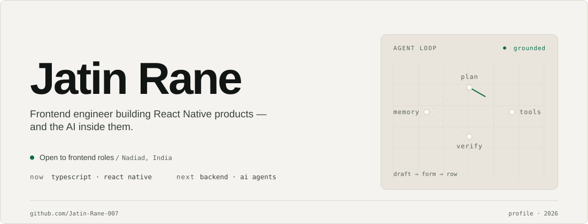

<picture>
  <source media="(prefers-color-scheme: dark) and (max-width: 700px)" srcset="assets/hero-dark-mobile.svg" />
  <source media="(prefers-color-scheme: dark)" srcset="assets/hero-dark.svg" />
  <source media="(max-width: 700px)" srcset="assets/hero-light-mobile.svg" />
  
</picture>

I build mobile products end to end in TypeScript — React Native and Next.js in front, Supabase and Clerk behind. Frontend developer at Groovy Web since 2023, now going deeper on backend systems and AI agents.

<picture>
  <source media="(prefers-color-scheme: dark) and (max-width: 700px)" srcset="assets/card-dark-mobile.svg" />
  <source media="(prefers-color-scheme: dark)" srcset="assets/card-dark.svg" />
  <source media="(max-width: 700px)" srcset="assets/card-light-mobile.svg" />
  
</picture>

## Contributions

<picture>
  <source media="(prefers-color-scheme: dark)" srcset="https://raw.githubusercontent.com/Jatin-Rane-007/Jatin-Rane-007/output/github-contribution-grid-snake-dark.svg" />
  <source media="(prefers-color-scheme: light)" srcset="https://raw.githubusercontent.com/Jatin-Rane-007/Jatin-Rane-007/output/github-contribution-grid-snake.svg" />
  
</picture>

## What I build

- Mobile products in Expo and React Native — the screens, the state, and the edge cases that only show up on a real device.
- Typed data layers on Supabase Postgres with Clerk identity, scoped by row-level security.
- AI features that stay grounded in real data: structured Gemini output, editable drafts, and null rather than a guess.

## Contact

Open to frontend roles.

[007rjatin@gmail.com](mailto:007rjatin@gmail.com) · [LinkedIn](https://www.linkedin.com/in/rane-jatin-852b331a9) · [GitHub](https://github.com/Jatin-Rane-007)
